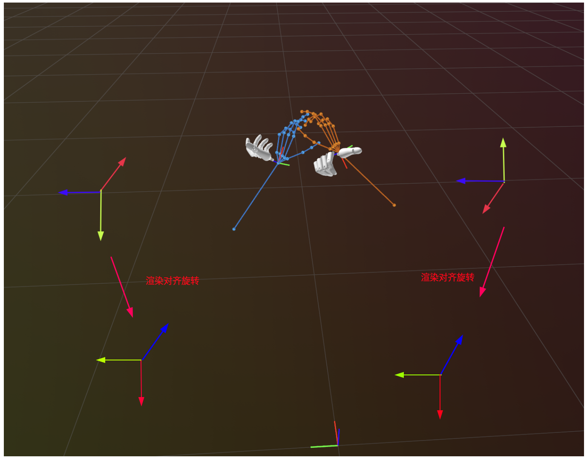
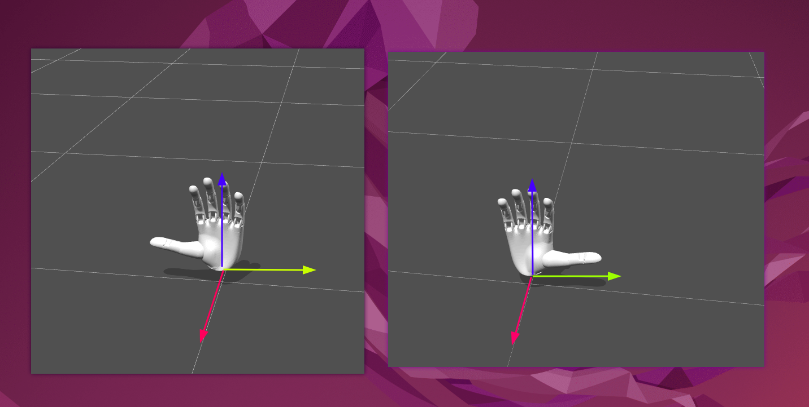

# EgoDex数据重定向

* 渲染的时候需要进行如下操作：
* 重定向的时候也需要进行如下操作，否则数据集中手指位姿转到局部坐标（手腕基座）的时候会与URDF中的定义不一致（手腕基z朝手指方向，），导致重定向错误。

1. avp数据都是`y` up的数据，转换为`z`  up习惯

   设上述原始坐标是$T^{avp}_{*}$，需要左乘 $T^{world}_{avp} = Rot_y(-90°)*Rot_z(-90°)$，先绕z轴旋转，再y轴。转换后，相应的$T^{world}_{*}$的可视化如下：

   > 原始数据重定向到具体灵巧手的的优化用这个$T^{world}_{*}$即可，无需后续步骤，后续是为了方便渲染

-- --

2.  如果需要基于urdf和mesh文件进行机器人的可视化，进行第1步后获得的$T^{world}_{wrist}$姿态如下图

，然后urdf和mesh中定义的机器人手是，如下：

所以为了方便可视化，即想染手部模型渲染的姿态和和骨骼图（$T^{world}_{*}$下各关键点的位置）姿态对齐。

对齐方法：z朝向是手向前的方向，左手大拇指与y轴相反，右手大拇指与y轴一致。所以，在rerun中渲染的时候我们需要如上图那样进行渲染对齐旋转。

​	